# INFOMAN1 — Week 11 Lab Answers

Name: Stephanie Mhay D. De Leon

Student ID: 2510576

GitHub repo: https://github.com/stepanotchie/infoman1

Date submitted: November 21, 2026

## Task 1 — Diagnose the Anomalies

**Approach / explanation:**
I used only SELECT queries on `student_enrollment` to show each anomaly. For the update anomaly I counted the rows carrying D01; for the insert anomaly I showed that IT103 has no home and simulated the placeholder student the table would force; for the delete anomaly I showed that Ana's IT102 row is the only copy of the IT102 course facts.

- **Update anomaly:** Renaming D01 means editing 3 rows for 1 fact, because department_name is stored once per enrollment row instead of once per department.
- **Insert anomaly:** IT103 (Intro to Networks, D01) cannot be stored without an invented placeholder student (NULL id / fake name / NULL grade), because course facts live inside the enrollment row.
- **Delete anomaly:** Removing Ana's IT102 row erases "IT102 / Web Development" entirely, because that enrollment row is the only place the course facts are stored.

**Code / query used (if applicable):**
```sql
-- (a) update anomaly
SELECT dept_id, department_name, COUNT(*) AS rows_a_rename_must_touch
FROM student_enrollment WHERE dept_id = 'D01' GROUP BY dept_id, department_name;

-- (b) insert anomaly
SELECT * FROM student_enrollment WHERE course_id = 'IT103';   -- empty set
SELECT NULL AS student_id, 'PLACEHOLDER' AS student_name, NULL AS enrolled_courses,
       'IT103' AS course_id, 'Intro to Networks' AS course_title, 'D01' AS dept_id,
       'Computing Studies' AS department_name, NULL AS grade
UNION ALL
SELECT student_id, student_name, enrolled_courses, course_id, course_title,
       dept_id, department_name, grade FROM student_enrollment;

-- (c) delete anomaly
SELECT course_id, course_title, dept_id, COUNT(*) AS rows_holding_this_course
FROM student_enrollment WHERE course_id = 'IT102'
GROUP BY course_id, course_title, dept_id;
SELECT DISTINCT course_id, course_title
FROM student_enrollment WHERE NOT (student_id = 101 AND course_id = 'IT102');
```

**Evidence (screenshot filename, output, or file reference in this folder):**
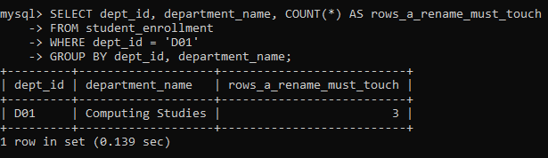

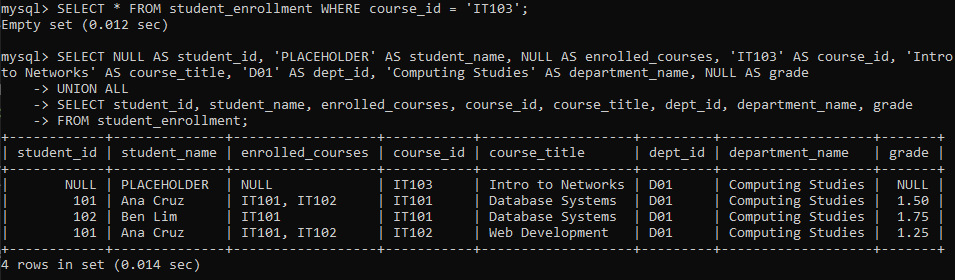

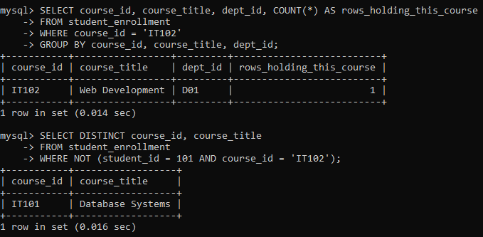

**Reflection question:**
The delete anomaly surprised me most: a single enrollment removal silently destroys an entire course. All three anomalies share one structural fact: student, course, and department facts are all stored together in one wide table, so each fact is tied to the enrollment row instead of having its own home.

## Task 2 — Reach First Normal Form

**Approach / explanation:**
I removed the multi-valued `enrolled_courses` cell by keeping one row per student-course pair, each with a single `course_id`. I created `student_enrollment_1nf` with a composite primary key `(student_id, course_id)` for row identity, then proved atomicity with SELECT output.

**Code / query used (if applicable):**
```sql
CREATE TABLE student_enrollment_1nf (
  student_id      INT           NOT NULL,
  student_name    VARCHAR(100)  NOT NULL,
  course_id       VARCHAR(10)   NOT NULL,
  course_title    VARCHAR(100)  NOT NULL,
  dept_id         VARCHAR(10)   NOT NULL,
  department_name VARCHAR(100)  NOT NULL,
  grade           DECIMAL(4,2),
  PRIMARY KEY (student_id, course_id)
);

INSERT INTO student_enrollment_1nf
  (student_id, student_name, course_id, course_title, dept_id, department_name, grade)
SELECT student_id, student_name, course_id, course_title, dept_id, department_name, grade
FROM student_enrollment;

SELECT * FROM student_enrollment_1nf ORDER BY student_id, course_id;
SELECT COUNT(*) AS cells_with_lists FROM student_enrollment_1nf
WHERE course_id LIKE '%,%' OR course_title LIKE '%,%' OR dept_id LIKE '%,%';
SELECT student_id, COUNT(*) AS courses_taken FROM student_enrollment_1nf GROUP BY student_id;
```

**Evidence (screenshot filename, output, or file reference in this folder):**
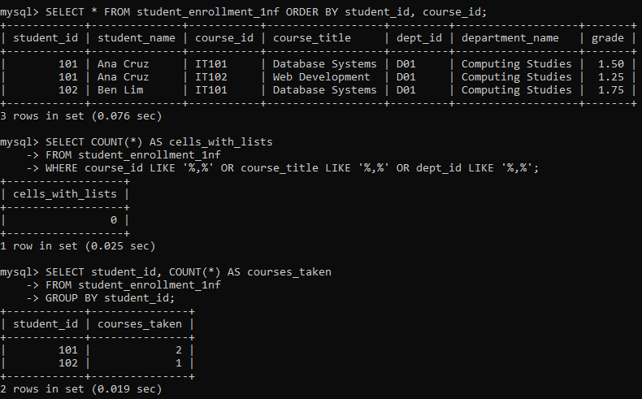

**Redundancy 1NF deliberately leaves behind:** `student_name` still repeats for Ana (2 rows), `course_title` repeats for IT101 (2 rows), and `department_name` repeats in all 3 rows. These are partial and transitive dependencies, which 1NF does not address; they are removed in Tasks 3–4.

**Reflection question:**
Splitting the cell only makes each cell atomic; the key is now `(student_id, course_id)`, and `student_name` depends on just the `student_id` half, so it repeats once per course. Second normal form (2NF) removes this next by moving half-key facts into their own tables.

## Task 3 — Reach Second Normal Form

**Approach / explanation:**
I identified the composite key `(student_id, course_id)` and listed every functional dependency. I then moved the half-key facts out into `students` and `courses_stage`, kept `enrollments` with the full key plus grade, and proved nothing was lost with a three-table join.

**Functional dependencies (composite key = `student_id, course_id`):**

| Dependency | Type |
|---|---|
| student_id → student_name | Partial (half the key) |
| course_id → course_title | Partial (half the key) |
| course_id → dept_id | Partial (half the key) |
| course_id → department_name | Partial (reached through dept_id) |
| dept_id → department_name | Non-key → non-key (transitive, fixed in Task 4) |
| (student_id, course_id) → grade | Full key |

**Code / query used (if applicable):**
```sql
CREATE TABLE students (
  student_id   INT           NOT NULL,
  student_name VARCHAR(100)  NOT NULL,
  PRIMARY KEY (student_id)
);

CREATE TABLE courses_stage (
  course_id       VARCHAR(10)   NOT NULL,
  course_title    VARCHAR(100)  NOT NULL,
  dept_id         VARCHAR(10)   NOT NULL,
  department_name VARCHAR(100)  NOT NULL,
  PRIMARY KEY (course_id)
);

CREATE TABLE enrollments (
  student_id INT          NOT NULL,
  course_id  VARCHAR(10)  NOT NULL,
  grade      DECIMAL(4,2),
  PRIMARY KEY (student_id, course_id),
  CONSTRAINT fk_enroll_student FOREIGN KEY (student_id) REFERENCES students (student_id),
  CONSTRAINT fk_enroll_course  FOREIGN KEY (course_id)  REFERENCES courses_stage (course_id)
);

INSERT INTO students SELECT DISTINCT student_id, student_name FROM student_enrollment_1nf;
INSERT INTO courses_stage SELECT DISTINCT course_id, course_title, dept_id, department_name FROM student_enrollment_1nf;
INSERT INTO enrollments SELECT student_id, course_id, grade FROM student_enrollment_1nf;

-- reconstructing join
SELECT s.student_id, s.student_name, c.course_id, c.course_title,
       c.dept_id, c.department_name, e.grade
FROM enrollments e
JOIN students s       ON s.student_id = e.student_id
JOIN courses_stage c  ON c.course_id  = e.course_id
ORDER BY s.student_id, c.course_id;
```

**Evidence (screenshot filename, output, or file reference in this folder):**
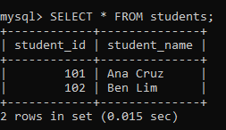

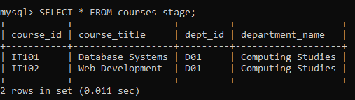

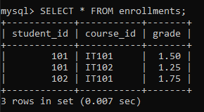

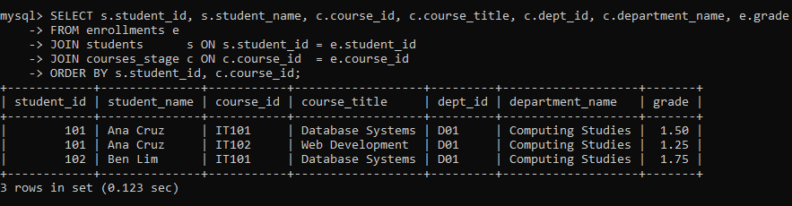

**Why grade stays with the full key:** a grade describes one student in one course, so it can only be determined by both `student_id` and `course_id` together.

**Reflection question:**
I ask "can I determine this column from just one half of the key?" Knowing only `student_id` is enough to know the student name (partial dependency), but knowing only a student or only a course never tells me the grade, so grade needs the whole key.

## Task 4 — Reach Third Normal Form

**Approach / explanation:**
The transitive chain is `course_id → dept_id → department_name`. I created `departments`, removed `department_name` from `courses_stage`, added the foreign key `courses.dept_id → departments.dept_id`, and renamed the table to `courses`. I then ran the decision path on every final table and rebuilt the full report with a four-table join.

**Code / query used (if applicable):**
```sql
CREATE TABLE departments (
  dept_id         VARCHAR(10)   NOT NULL,
  department_name VARCHAR(100)  NOT NULL,
  PRIMARY KEY (dept_id)
);
INSERT INTO departments SELECT DISTINCT dept_id, department_name FROM courses_stage;

ALTER TABLE courses_stage DROP COLUMN department_name;
ALTER TABLE courses_stage
  ADD CONSTRAINT fk_courses_dept FOREIGN KEY (dept_id) REFERENCES departments (dept_id);
RENAME TABLE courses_stage TO courses;

-- four-table join
SELECT s.student_id, s.student_name, c.course_id, c.course_title,
       d.department_name, e.grade
FROM enrollments e
JOIN students s     ON s.student_id = e.student_id
JOIN courses c      ON c.course_id  = e.course_id
JOIN departments d  ON d.dept_id    = c.dept_id
ORDER BY s.student_id, c.course_id;
```

**Decision-path verdicts (multi-valued? → partial? → transitive?):**

| Table | Primary key | Multi-valued? | Partial dependency? | Transitive dependency? | Verdict |
|---|---|---|---|---|---|
| students | student_id | No | No (single-column key) | No (student_name depends directly on student_id) | 3NF |
| departments | dept_id | No | No (single-column key) | No (department_name depends directly on dept_id) | 3NF |
| courses | course_id | No | No (single-column key) | No (dept_id is a foreign key; department_name moved out) | 3NF |
| enrollments | (student_id, course_id) | No | No (grade needs the full key) | No (grade is the only non-key column) | 3NF |

**Evidence (screenshot filename, output, or file reference in this folder):**
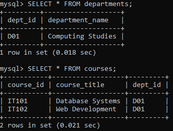

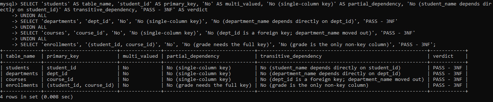

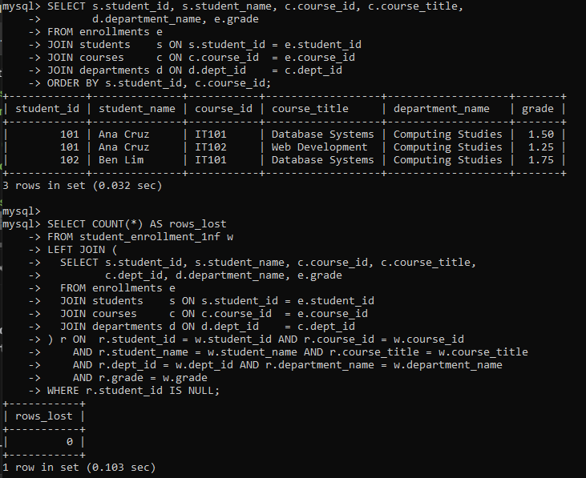

**Reflection question:**
`department_name` depends on `course_id` only through the non-key column `dept_id`, so it is a transitive dependency. The four-table join returns all 3 original rows with every value intact, and the lossless check (`rows_lost = 0`) confirms no data or key was dropped.

## Task 5 — Reflection

**Approach / explanation:**
I compared the Task 1 update anomaly with the Task 4 result, then described a real mistake from my Task 2 stage (stopping at 1NF) with its symptom and fix. 


> I would normalize a campus enrollment system to 3NF because students, courses, and departments change independently. In Task 1, renaming Computing Studies meant editing three rows of student_enrollment; after Task 4 it is one row in departments, so the name can never conflict with itself. I would deliberately keep some denormalized repetition only in a read-only reporting table or semester snapshot, such as a transcript export that copies course_title and department_name so a past transcript stays unchanged when a department is later renamed and the report needs no four-table join.
>
> One mistake I made was stopping at 1NF. After splitting enrolled_courses into one row per student-course pair, with a primary key on (student_id, course_id), I assumed the redundancy was gone. The symptom was that Ana Cruz's name and the Database Systems title still repeated across rows, so a rename still needed multiple edits. I listed the functional dependencies, saw that student_name and course_title depended on only half of the key, and split them into students, courses, and enrollments, then departments for 3NF.

**Reflection question:**
I would keep denormalized repetition on purpose in read-only reporting or historical snapshot tables, never in the operational tables. The single symptom that a split dropped a key is a JOIN that returns fewer rows (or no rows) than the original table, which is why I ran the `rows_lost = 0` check.

## Self-Check

- [] All tasks committed with individual, meaningful commit messages
- [] All files placed inside `week11/`
- [] This file completed and renamed `answers.md`
- [] Repository link pasted into Moodle (no files uploaded)