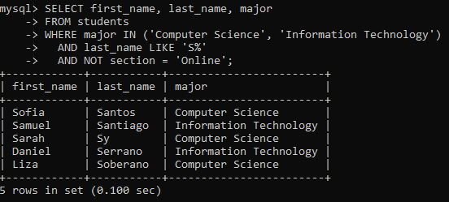
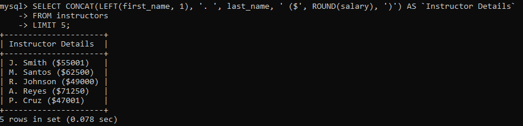
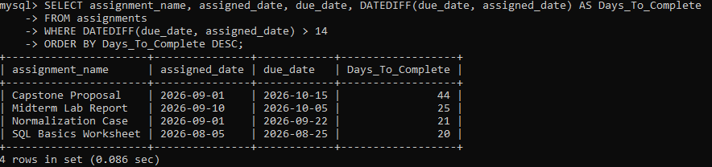
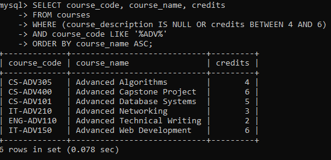

# INFOMAN1 — Week 7 Lab Answers
 
 
## Task 1 — Complex Student Roster
 
**Approach / explanation:**
I filtered the `students` table with three conditions joined by `AND`. `IN` checks that the major is either 'Computer Science' or 'Information Technology', `LIKE 'S%'` keeps last names that start with S, and `NOT section = 'Online'` removes students enrolled in the Online section. Five students match: Santos, Santiago, Sy, Serrano and Soberano. Anna Smith and Miguel Santos are excluded because they are in the Online section.
 
**Code / query used (if applicable):**
```sql
SELECT first_name, last_name, major
FROM students
WHERE major IN ('Computer Science', 'Information Technology')
  AND last_name LIKE 'S%'
  AND NOT section = 'Online';
```
 
**Evidence (screenshot filename, output, or file reference in this folder):**
Screenshot: `task1_output.png`
 

 
```
+------------+-----------+------------------------+
| first_name | last_name | major                  |
+------------+-----------+------------------------+
| Sofia      | Santos    | Computer Science       |
| Samuel     | Santiago  | Information Technology |
| Sarah      | Sy        | Computer Science       |
| Daniel     | Serrano   | Information Technology |
| Liza       | Soberano  | Computer Science       |
+------------+-----------+------------------------+
```
 
**Reflection question:**
Why is it often better to use the `IN` operator rather than chaining multiple `OR` conditions when filtering by a specific list of values?
`IN` is shorter and easier to read because the list of values is written once in a single condition, instead of repeating the column name for every `OR`. It is also less error-prone: with chained `OR`s it is easy to mix them up with `AND` and get the wrong precedence, but `IN (...)` is one self-contained condition. Adding or removing a value later is a one-word edit, and the optimizer can treat the list efficiently.
 
---
 
## Task 2 — Formatting Employee Data
 
**Approach / explanation:**
I used `LEFT(first_name, 1)` to get the first initial and `CONCAT` to join it with a period, a space, the full last name, and the salary in parentheses with a `$` sign. `ROUND(salary)` with no decimal argument rounds to the nearest whole number. The result is aliased as `Instructor Details` (in backticks because it has a space), and `LIMIT 5` returns only the first 5 rows. Note: `ROUND` rounds half up, so John Smith's 55000.75 becomes 55001, not 55000.
 
**Code / query used (if applicable):**
```sql
SELECT CONCAT(LEFT(first_name, 1), '. ', last_name, ' ($', ROUND(salary), ')') AS `Instructor Details`
FROM instructors
LIMIT 5;
```
 
**Evidence (screenshot filename, output, or file reference in this folder):**
Screenshot: `task2_output.png`
 

 
Text output of the first 5 rows:
 
```
+---------------------+
| Instructor Details  |
+---------------------+
| J. Smith ($55001)   |
| M. Santos ($62500)  |
| R. Johnson ($49000) |
| A. Reyes ($71250)   |
| P. Cruz ($47001)    |
+---------------------+
```
 
**Reflection question:**
How do string functions like `CONCAT` affect the performance of a query compared to retrieving raw columns and formatting them in the application layer (e.g., in Java or Python)?
For a small table like this one the difference is negligible. In general, `CONCAT` runs on the database server for every returned row, so on very large result sets it uses server CPU that is shared by all users, while formatting in the application moves that work to the app servers, which are easier to scale. Formatting in SQL can reduce the code you write and keeps output consistent, but if the function is used in a `WHERE` clause on a column it can prevent index use. A good rule is to do light formatting in SQL for reports and exports, and do heavy or presentation-specific formatting in the application layer.
 
---
 
## Task 3 — Project Deadline Analysis
 
**Approach / explanation:**
I used `DATEDIFF(due_date, assigned_date)` with the later date first so the result is a positive number of days, and aliased it as `Days_To_Complete`. Because `WHERE` runs before the `SELECT` aliases exist, I repeated the `DATEDIFF` expression in the `WHERE` clause to keep only assignments longer than 14 days. `ORDER BY Days_To_Complete DESC` sorts from longest to shortest, since `ORDER BY` runs after `SELECT` and can use the alias. Four assignments qualify.
 
**Code / query used (if applicable):**
```sql
SELECT assignment_name,
       assigned_date,
       due_date,
       DATEDIFF(due_date, assigned_date) AS Days_To_Complete
FROM assignments
WHERE DATEDIFF(due_date, assigned_date) > 14
ORDER BY Days_To_Complete DESC;
```
 
**Evidence (screenshot filename, output, or file reference in this folder):**
Screenshot: `task3_output.png`
 

 
```
+----------------------+---------------+------------+------------------+
| assignment_name      | assigned_date | due_date   | Days_To_Complete |
+----------------------+---------------+------------+------------------+
| Capstone Proposal    | 2026-09-01    | 2026-10-15 |               44 |
| Midterm Lab Report   | 2026-09-10    | 2026-10-05 |               25 |
| Normalization Case   | 2026-09-01    | 2026-09-22 |               21 |
| SQL Basics Worksheet | 2026-08-05    | 2026-08-25 |               20 |
+----------------------+---------------+------------+------------------+
```
 
**Reflection question:**
Why is column aliasing particularly important when using mathematical or date functions in the `SELECT` clause?
Without an alias, MySQL names the column after the whole expression (for example `DATEDIFF(due_date, assigned_date)`), which is hard to read in reports and awkward for applications to reference by name. An alias gives the calculated value a clear, meaningful name such as `Days_To_Complete`, and it can be reused in `ORDER BY`. It also makes the output understandable to people who did not write the query.
 
---
 
## Task 4 — Comprehensive Data Audit
 
**Approach / explanation:**
The requirement is "(description is missing OR credits between 4 and 6) AND code contains ADV". I wrapped the `OR` conditions in parentheses so they are evaluated together first, and the `ADV` check applies to every row as a required condition. `IS NULL` is used for the missing description (not `= NULL`), `BETWEEN 4 AND 6` includes both 4 and 6, and `LIKE '%ADV%'` matches 'ADV' anywhere in the course code. Results are sorted alphabetically with `ORDER BY course_name`. Six courses match.
 
**Code / query used (if applicable):**
```sql
SELECT course_code, course_name, credits
FROM courses
WHERE (course_description IS NULL OR credits BETWEEN 4 AND 6)
  AND course_code LIKE '%ADV%'
ORDER BY course_name ASC;
```
 
**Evidence (screenshot filename, output, or file reference in this folder):**
Screenshot: `task4_output.png`
 

 
```
+-------------+----------------------------+---------+
| course_code | course_name                | credits |
+-------------+----------------------------+---------+
| CS-ADV305   | Advanced Algorithms        |       4 |
| CS-ADV400   | Advanced Capstone Project  |       6 |
| CS-ADV101   | Advanced Database Systems  |       5 |
| IT-ADV210   | Advanced Networking        |       3 |
| ENG-ADV110  | Advanced Technical Writing |       2 |
| IT-ADV150   | Advanced Web Development   |       6 |
+-------------+----------------------------+---------+
```
 
**Precedence explanation:** In SQL, `AND` has higher precedence than `OR`. Without parentheses, my condition would be read as `description IS NULL OR (credits BETWEEN 4 AND 6 AND code LIKE '%ADV%')`. That version also returns `CS-101 Introduction to Computing`, which has a NULL description but no 'ADV' in its code, so it is wrong (7 rows instead of 6). With parentheses, MySQL first evaluates `(IS NULL OR BETWEEN)` and then applies `AND code LIKE '%ADV%'`, so every returned row must contain 'ADV'.
 
**Reflection question:**
Explain how MySQL evaluates the expression `A OR B AND C`. How did you use parentheses (if you did) to ensure your query filtered the exact data requested in the instructions?
MySQL evaluates `AND` before `OR`, so `A OR B AND C` is treated as `A OR (B AND C)`: a row passes if A is true, or if both B and C are true. Since the task needs C (`code LIKE '%ADV%'`) to be true for every row, I wrote `(A OR B) AND C` with parentheses, where A is `course_description IS NULL` and B is `credits BETWEEN 4 AND 6`. This forces the `OR` to be evaluated first and prevents rows like CS-101 (NULL description, no ADV) from slipping through.
 
---
 
## Self-Check
 
- [ ] All tasks committed with individual, meaningful commit messages
- [ ] All files placed inside `week7/`
- [ ] This file completed and renamed `answers.md`
- [ ] Repository link pasted into Moodle (no files uploaded)
 